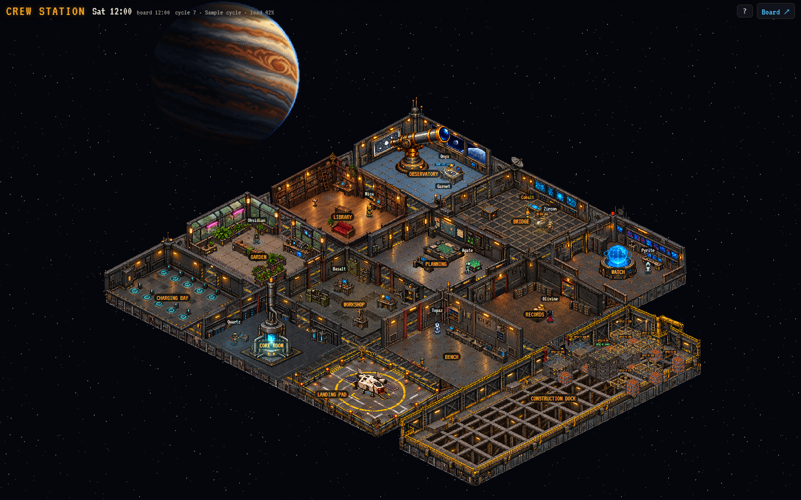
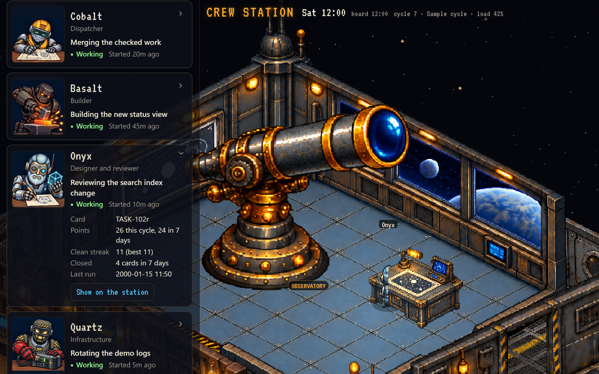
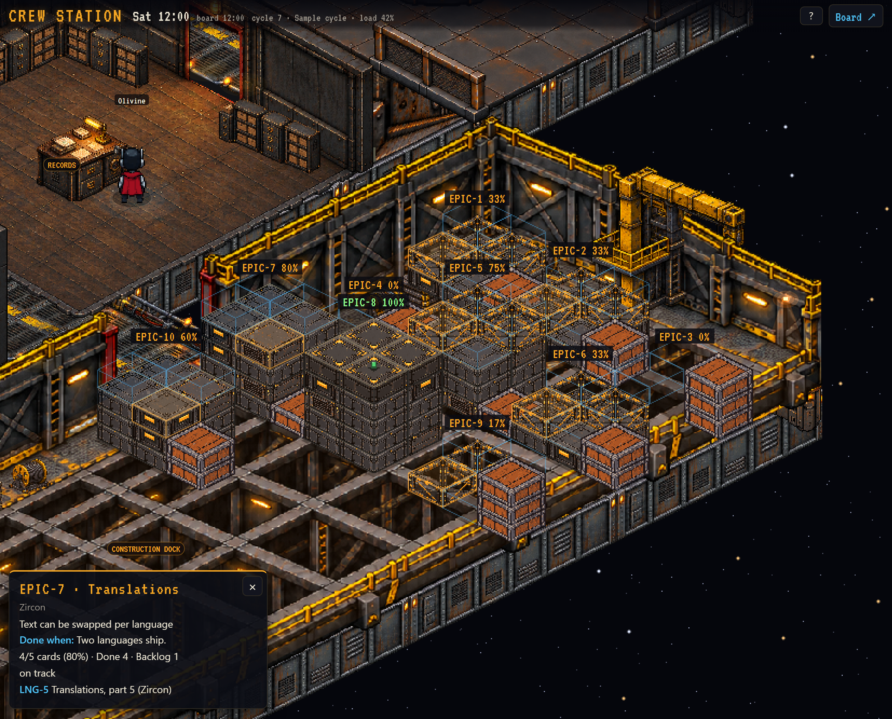
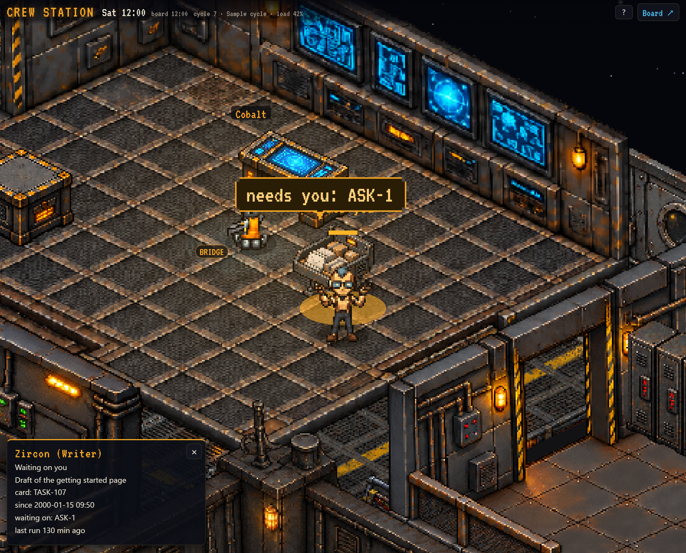

# Crew Station

An isometric pixel-art space station in the browser, where a crew of robots acts out the work on a board.



- [Crew Station](#crew-station)
  - [Introduction](#introduction)
    - [Features](#features)
    - [Preview](#preview)
  - [Installation](#installation)
  - [Updating](#updating)
  - [Uninstalling](#uninstalling)
  - [Usage](#usage)
    - [Feeding it your own board](#feeding-it-your-own-board)
    - [URL switches](#url-switches)
  - [Learn more](#learn-more)
  - [Making Contributions](#making-contributions)
  - [Acknowledgments](#acknowledgments)
  - [License](#license)

## Introduction

Crew Station turns a JSON work board into a place you can watch. Robots sit at their desks when the data says they are working, carry parcels when work changes hands, charge at night, and build the construction dock block by block as projects close. A crew panel beside the station lists who is doing what.

It is static HTML, CSS and JavaScript, with no build step and no backend. It reads one JSON file and ships with an invented sample board at `data/sample-board.json`.

### Features

* Thirteen rooms and a crew of robots, all as data you can change.
* A crew panel with who needs attention, who is working, and details for each member.
* Figures that follow the board: working, blocked, waiting on you, or charging.
* Parcels that carry real events from one crew member to another, and tags showing review results.
* A construction dock where each epic becomes a stack of modules as its cards close.
* Day and night lighting, with lit rooms where someone is working.
* Works on desktop and phone widths, with a bottom bar on phones.
* Handles slow links: a capped loading queue with retries and a visible error rather than a hang, and it redraws itself when a phone drops its canvases in the background.

### Preview

**Crew member details:** the crew panel, with one member open.



**Construction dock:** an epic pulled up over its stacks.



**Waiting on you:** a crew member asking for an answer.



## Installation

```sh
git clone https://github.com/fatherdoctor/crew-station.git
cd crew-station
python3 -m http.server 8000
```

Then open http://localhost:8000/. Any static web server works. Opening `index.html` directly from disk does not, because the page fetches JSON.

To place it in another project, copy `index.html`, `css/`, `js/`, `assets/` and `data/` into one served folder, along with `LICENSE` and `NOTICE.md`. [AGENTS.md](AGENTS.md#using-it-in-another-project) has the steps.

## Updating

Pull the latest version, or copy the new files over your folder and keep your own board file. If you changed crew or rooms, run `node tools/check.js` afterward. A new version may be cached by browsers, so serve it from a new folder or clear the cache if you see the old page.

## Uninstalling

Delete the folder. Nothing else is installed, and the page keeps only small view settings in the browser's session storage.

## Usage

Open the page and watch. Drag or use the keyboard to move around, zoom in on a room, and tap a figure, room or dock module for its caption. The crew panel opens the details for each member. [AGENTS.md](AGENTS.md#input) lists all the controls.

### Feeding it your own board

Write a JSON file in the format documented in [the board schema](AGENTS.md#board-schema), then point the page at it. Strongest first:

* In the URL: `index.html?board=/api/board.json`
* In the page: `<meta name="crew-board-url" content="/api/board.json">` in `index.html`
* As the default: the `boardUrl()` line in `js/config.js`

Check your file with:

```sh
node tools/check.js --board my-board.json
```

### URL switches

* `?demo=1` rotates the crew through their states.
* `?night=1` forces night.
* `?board=<url>` reads another board file.

[AGENTS.md](AGENTS.md#url-switches) lists them all.

## Learn more

* [AGENTS.md](AGENTS.md): the full guide, written for coding agents and useful to anyone. It covers the board schema, live data, adding crew, rooms and desks, changing art, and placing it in another project.
* [docs/ARCHITECTURE.md](docs/ARCHITECTURE.md): how the code is organized.
* [art-kit/](art-kit/ART-GUIDE.md): for making new art that matches: a style guide, wireframe guides, sprite sheet templates, reference stills and scripts. The page does not load anything from it.

## Making Contributions

Want to contribute? See the [Development](./DEVELOPMENT.md) documentation for setup instructions. No need to open an issue first: pull requests are welcome directly.

## Acknowledgments

Thank you to Andrew Sims and [StarNet](https://github.com/androoAGI/starnet), which inspired this station. This project includes no StarNet code or asset files.

## License

MIT, see [LICENSE](LICENSE). The VT323 font is under the SIL OFL 1.1; see [NOTICE.md](NOTICE.md).
